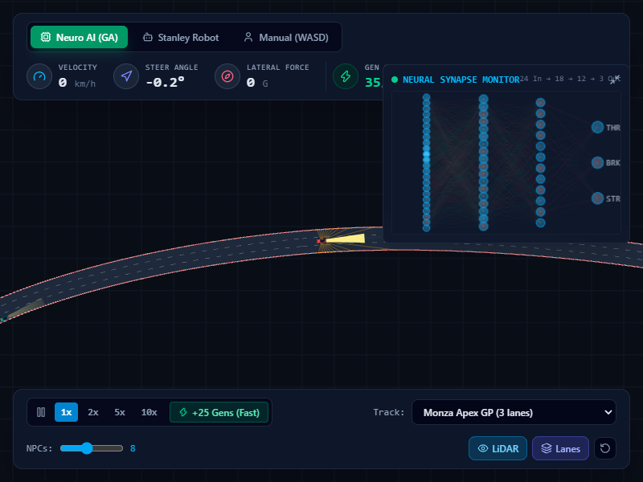
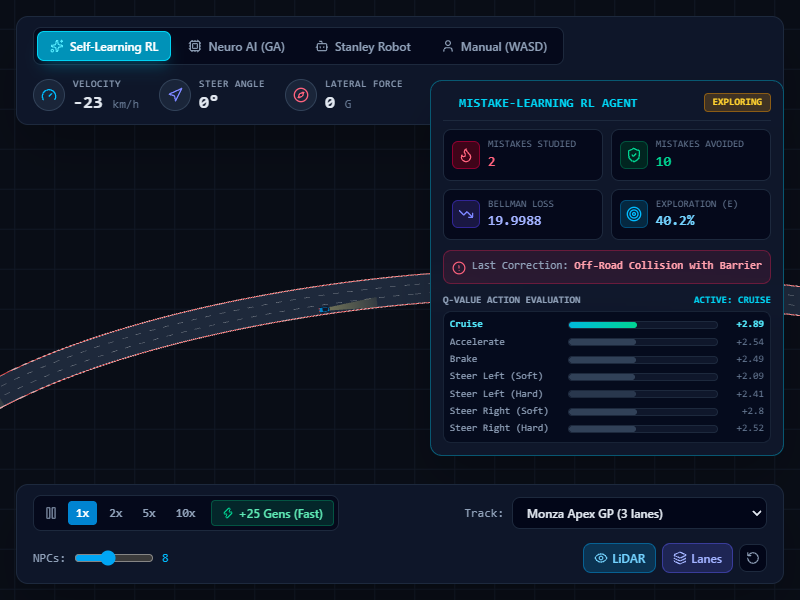
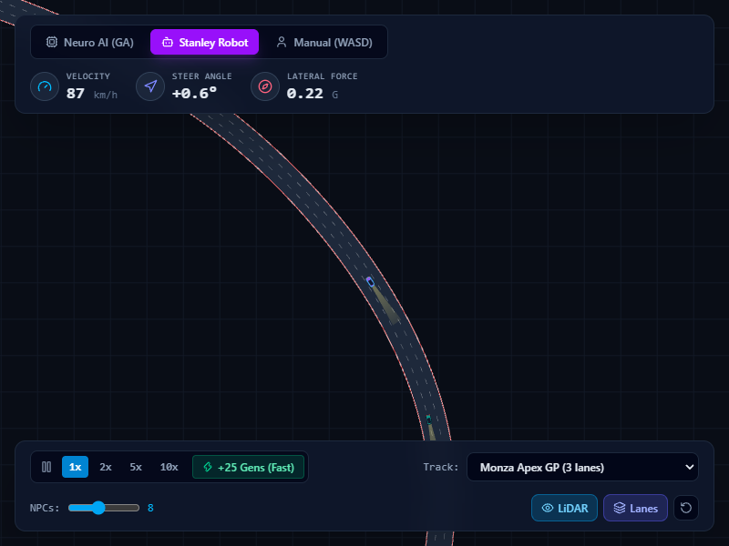
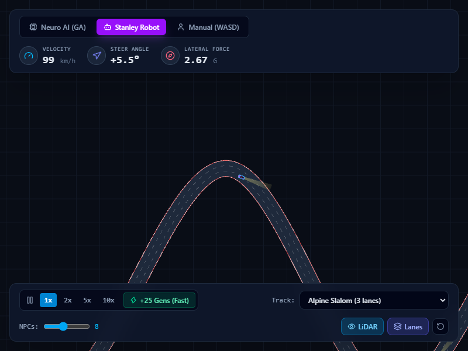

# Nexus AV Simulator

Nexus AV Simulator is an autonomous vehicle research and simulation platform built with TypeScript, React 19, HTML5 Canvas, and Tailwind CSS.

It moves beyond simplified straight line toy models by implementing genuine autonomous vehicle engineering concepts: procedural spline road networks, kinematic bicycle dynamics, multi-agent microscopic traffic, multi-modal perception, and multi-paradigm autonomous control systems.



## Core Capabilities

### 1. Curvilinear Road Geometry & Coordinate Systems
* **Catmull-Rom & Bezier Splines**: Multi-lane tracks with analytical arc-length reparameterization.
* **Frenet Frame Transformation**: Continuous mapping between Cartesian `(x, y)` and Frenet `(s, d)` coordinates (longitudinal track distance and lateral lane offset).
* **Presets**: Monza Apex GP, Neo Tokyo Expressway, Alpine Slalom, and an Infinite Highway benchmark.

### 2. Vehicle Dynamics
* **Kinematic Bicycle Model**: Real Ackermann steering geometry, wheelbase dynamics, and steer rate limits.
* **Tire Adhesion & Slip**: Calculates lateral acceleration and detects loss of traction during aggressive cornering.
* **Separating Axis Theorem (SAT)**: Exact collision detection between rotated vehicle bounding polygons and track curbs.

### 3. Perception Stack
* **360 Degree LiDAR**: Multi-beam raycasting with distance normalization and obstacle classification (road curbs vs dynamic vehicles).
* **Doppler Radar**: Leading vehicle detection providing relative distance and relative velocity ($\Delta v$) for cruise control.

### 4. Microscopic Traffic Simulation
* **Intelligent Driver Model (IDM)**: Realistic car-following dynamics maintaining time headway and comfortable deceleration gaps.
* **MOBIL Model**: Polite lane-changing decision criteria balancing ego advantage against follower disruption.

### 5. Multi-Paradigm Autonomous Brains
* **Self-Learning RL (Deep Q-Learning with Mistake Replay)**: A neural agent that calculates Temporal Difference error and backpropagates gradients in real time. It utilizes a prioritized memory buffer that samples past collisions, spins, and near-misses on every frame so it specifically learns to avoid repeating past mistakes.
* **Neuroevolution Pilot (GA)**: Multi-layer perceptron evolved across generations with elitism, uniform crossover, and adaptive Gaussian mutation.
* **Stanley / Pure Pursuit Controller**: Classical robotics baseline combining lookahead path curvature tracking with adaptive cruise control.
* **Manual Driver Mode**: Direct keyboard control (WASD / Arrows) to test how autonomous agents react to human driving.







## Architecture Overview

```
src/
├── core/
│   ├── math/
│   │   ├── Vector2D.ts         # Vector operations, projections, rotations
│   │   ├── Spline.ts           # Arc-length parameterised Catmull-Rom splines
│   │   ├── Frenet.ts           # Cartesian to Frenet coordinate frame
│   │   └── Collision.ts        # SAT polygon collision and raycasting
│   ├── physics/
│   │   ├── VehicleModel.ts     # Kinematic bicycle model and Ackermann steering
│   │   └── VehicleState.ts     # Vehicle state representation and limits
│   ├── sensors/
│   │   ├── LidarSensor.ts      # Multi-beam raycaster with obstacle classification
│   │   └── RadarSensor.ts      # Forward Doppler radar tracking leading cars
│   ├── traffic/
│   │   ├── IDM.ts              # Intelligent Driver Model car following
│   │   ├── MOBIL.ts            # Polite lane changing criteria
│   │   └── TrafficManager.ts   # NPC fleet orchestrator
│   ├── ai/
│   │   ├── BackpropNetwork.ts  # Densely connected network with momentum backprop
│   │   ├── DeepQLearning.ts    # Deep Q-Network with Prioritized Mistake Memory
│   │   ├── NeuralNetwork.ts    # Float32Array MLP with live layer introspection
│   │   ├── GeneticAlgorithm.ts # Elitist neuroevolution engine
│   │   └── ClassicController.ts# Pure Pursuit + ACC controller
│   └── engine/
│       └── Simulation.ts       # Unified physics stepper and headless training loop
├── renderer/
│   ├── CanvasRenderer.ts       # High-DPI 2D canvas drawing engine
│   └── Camera.ts               # Smooth target-tracking camera with zoom
└── components/
    ├── Cockpit.tsx             # Real-time telemetry HUD (speed, steer angle, G-meter)
    ├── BrainVisualizer.tsx     # Live animated neural synapse monitor
    ├── MistakeLearningHUD.tsx  # Q-values, mistake memory, TD loss monitor
    └── ControlPanel.tsx        # Time scale, track preset, and traffic density controls
```

## Getting Started

### Prerequisites
* Node.js 18+ (tested on Node v24)
* npm 9+

### Installation & Run

```bash
# Clone or navigate to the project directory
cd nexus-av-simulator

# Install dependencies
npm install

# Start development server
npm run dev
```

Open `http://localhost:5173` in your browser.

### Key Controls
* **Space**: Pause / Resume simulation
* **W / Up**: Throttle (Manual Mode)
* **S / Down**: Brake / Reverse (Manual Mode)
* **A / D / Left / Right**: Steer Left / Right (Manual Mode)
* **Mouse Scroll**: Zoom camera in / out

## License

MIT
