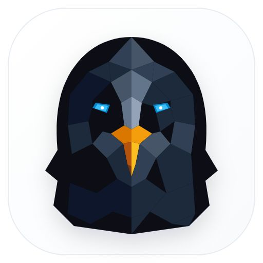
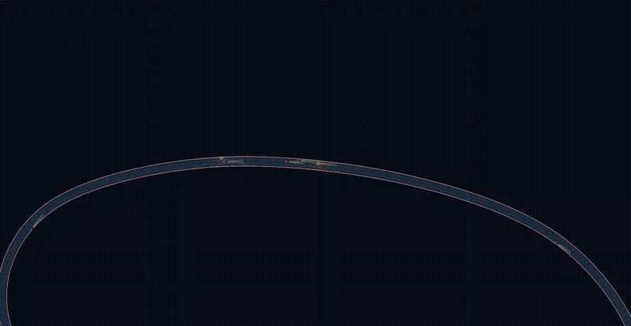
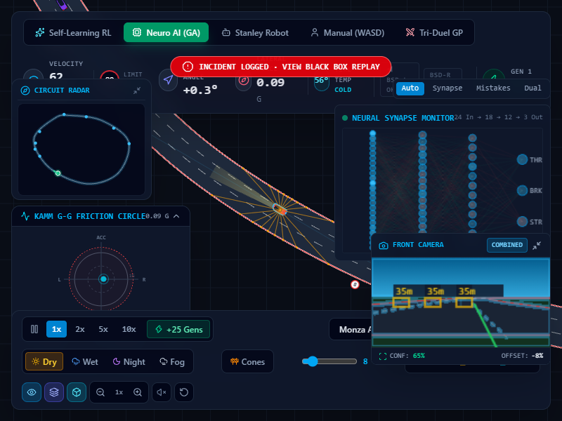
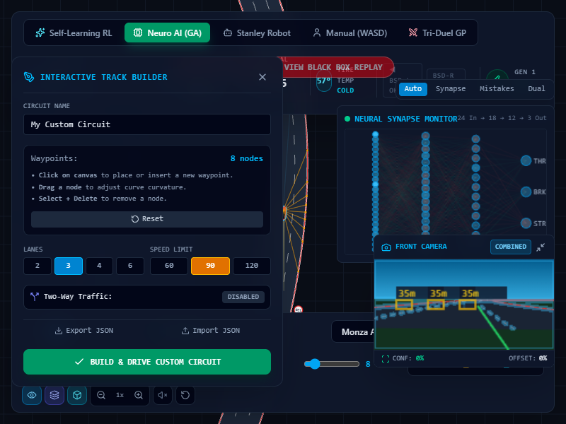
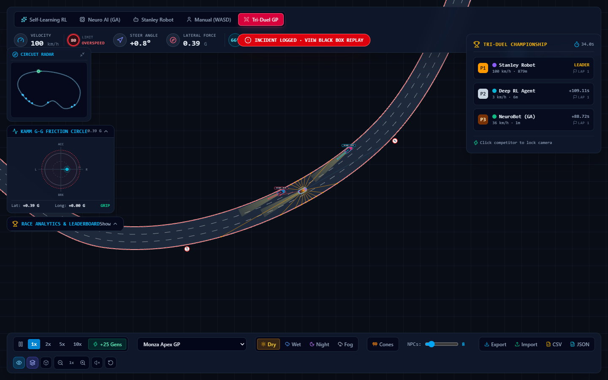
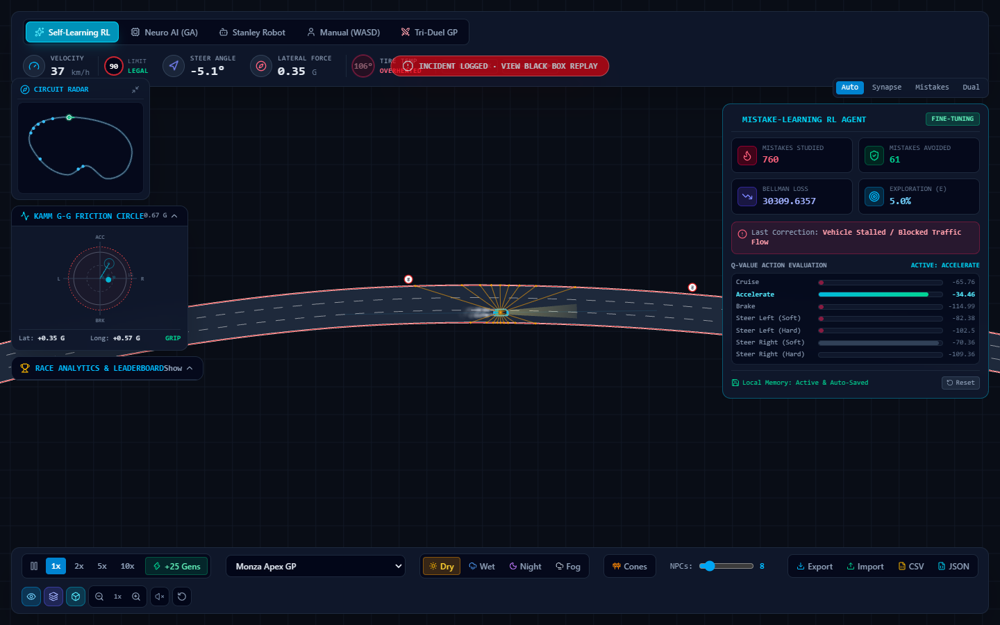
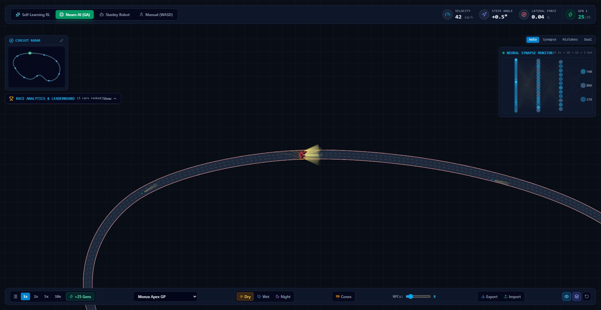
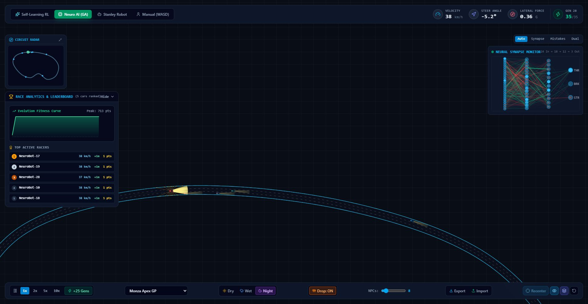
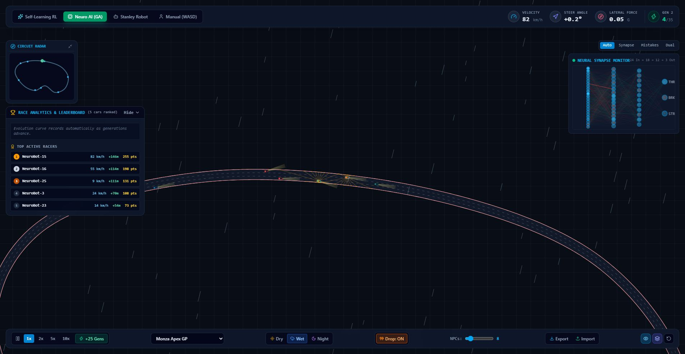
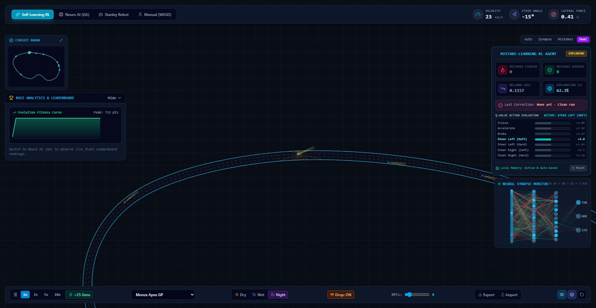

<h1 align="center">
  <br>
  Nexus AV Simulator
</h1>

<p align="center">
  <b>Multi-paradigm autonomous vehicle simulation platform in TypeScript and 2D canvas.</b><br>
  Simulates kinematic bicycle vehicle dynamics, 360-degree LiDAR perception, intelligent multi-agent traffic, neuroevolution, and mistake-driven reinforcement learning.
</p>

<p align="center">
  <a href="https://github.com/alexandrmotologa/nexus-av-simulator"></a>
  <a href="LICENSE"></a>
  
  
  
  
</p>

<p align="center">
  
</p>

---

## Overview

Nexus AV Simulator is an engineering platform designed to study autonomous vehicle motion planning, real-time sensor perception, and multi-paradigm AI driving controllers directly in browser environments.

The simulator implements numerical vehicle dynamics, geometric collision checks using the Separating Axis Theorem (SAT), 360-degree LiDAR raycasting, Doppler radar, and surrounding traffic governed by car-following and lane-changing models.

---

## Visual Previews

<div align="center">
  
  <p><i>Synthetic Computer Vision HUD: Forward driver perspective with discrete 2D Sobel edge detection, lane boundary lock, obstacle bounding boxes with distance tags, and sign-synchronized road markings.</i></p>
</div>

<div align="center">
  
  <p><i>Interactive Track Builder: Real-time road network editor supporting arbitrary waypoint placement, curve curvature tuning, lane counts (2 to 6), bidirectional traffic flows, and JSON storage.</i></p>
</div>

<div align="center">
  
  <p><i>Grand Prix Tri-Duel: Deep RL, NeuroBot GA, and Stanley Robot racing concurrently with live championship leaderboard.</i></p>
</div>

<div align="center">
  
  <p><i>Sensor Fusion visualizer rendering 2D bounding boxes, velocity vectors, and threat classifications for surrounding obstacles and traffic.</i></p>
</div>

<div align="center">
  
  <p><i>Real-time cockpit telemetry with 360-degree LiDAR perception beams and active circuit radar.</i></p>
</div>

<div align="center">
  
  <p><i>Cyberpunk Night atmosphere: pitch-dark tarmac, neon cyan rumble strips, and generational fitness curve.</i></p>
</div>

<div align="center">
  
  <p><i>Wet weather conditions with reduced tire grip (4.5 m/s²), diagonal rain streaks, and interactive traffic cones.</i></p>
</div>

<div align="center">
  
  <p><i>Dual inspector view: Mistake-Learning RL HUD alongside real-time neural synapse activations.</i></p>
</div>

---

## Core Systems

### 1. Vehicle Dynamics Engine & Pacejka Tire Model
The simulator models vehicle mechanics through a continuous-time single-track model with dynamic load transfer and non-linear tire mechanics:
* **Position and Heading**: Updated via numerical integration.
* **Dynamic Weight Transfer**: Calculates longitudinal axle load shifts during braking and acceleration:
  $$\Delta F_z = \frac{m \cdot a_x \cdot h_{\text{cg}}}{L}, \quad F_{zf} = F_{zf0} - \Delta F_z, \quad F_{zr} = F_{zr0} + \Delta F_z$$
* **Pacejka Magic Formula**: Evaluates non-linear lateral tire forces based on tire slip angles ($\alpha_f, \alpha_r$):
  $$F_y = D \sin\left(C \arctan(B\alpha - E(B\alpha - \arctan(B\alpha)))\right)$$
* **Slip Angle**: Computed using front/rear wheel base distances ($l_f = 1.3\text{ m}$, $l_r = 1.5\text{ m}$):
  $$\beta = \arctan\left(\frac{l_r}{l_f + l_r} \tan(\delta)\right)$$
* **Transmission**: Forward acceleration up to 160 km/h and dedicated reverse gear up to 50 km/h with directional braking transition.

### 2. Road Signage and Synchronized Road Markings
Road markings are strictly coupled with road signage and curvature:
* **Hazard & Sharp Curve Zones**: Lane dividers transition into continuous solid white lines (`SOLID_WHITE`), legally prohibiting lane changes and overtaking.
* **Approach Transition**: Preceded by warning dashed lines (`WARNING_DASHED_WHITE`, 4.5m dash, 1.5m gap) alerting drivers of upcoming restrictions.
* **Straight Cruise Sectors**: Standard dashed white lines (`DASHED_WHITE`, 3.0m dash, 3.2m gap) where overtaking is permitted.
* **Opposing Traffic Median**: Prominent double solid yellow line (`DOUBLE_SOLID_YELLOW`) in bidirectional circuits.

### 3. Synthetic Computer Vision & Virtual Front Camera
* **Driver Perspective Projection**: Projects a 72-degree field of view forward frustum from the front bumper onto a 160x80 canvas.
* **Discrete 2D Edge Detection**: Computes horizontal and vertical Sobel convolution kernels ($G_x, G_y$) to extract gradient magnitude maps.
* **Feature Extraction**: Scans road region of interest (ROI) to detect lane boundary offsets and cluster obstacle bounding boxes with distance tags.

### 4. Smart Infrastructure & V2X Signalized Intersections
* **4-Phase Traffic Signals**: Red, Yellow, Green, and All-Red clearance cycles with induction loops.
* **V2I Telemetry Beacons**: Broadcasts Signal Phase and Timing (SPaT) data to approaching connected vehicles.
* **Green Wave Speed Advisory**: Computes optimal approach velocity to clear upcoming intersections on green without stopping.

### 5. Continuous Actor-Critic & Behavioral Cloning
* **Dual-Head Architecture**: Actor outputs continuous mean steering $\mu_\delta \in [-1, 1]$ and throttle $\mu_a \in [-1, 1]$ with Gaussian standard deviations; Critic estimates baseline state value $V(s)$.
* **Generalized Advantage Estimation (GAE)**: Updates continuous policy gradients with advantage normalization.
* **Behavioral Cloning Recorder**: Records human driving trajectories and pre-trains Actor weights via supervised gradient descent.

### 6. 360-Degree Sensor Suite
* **LiDAR Sensor**: Casts up to 24 planar rays across 360 degrees. Ray intersections are evaluated against track boundaries, NPC traffic hulls, and road obstacles using optimized ray-circle and ray-segment tests.
* **Doppler Radar**: Forward long-range sensor tracking distance, azimuth, and relative approach velocity ($\Delta v$) of leading obstacles up to 70 meters.

### 7. Multi-Agent Intelligent Traffic
Surrounding civilian traffic operates autonomously through coupled macroscopic and microscopic models:
* **IDM (Intelligent Driver Model)**: Calculates longitudinal acceleration based on desired velocity, safe time headway, and minimum spacing.
* **MOBIL (Minimizing Overall Braking Induced by Lane Changes)**: Evaluates politeness factors and acceleration incentives before executing lane shifts.
* **Road Rule Compliance**: NPC vehicles strictly check `isLaneChangeAllowed(laneFrom, laneTo, s)` and never change lanes across solid lines or in curves.
* **Active Hazard Avoidance**: Traffic vehicles detect stopped wrecks and road cones, calculating lane offsets to bypass obstructions safely.
* **Turn Signals and Brake Halos**: Vehicles engage 1.75 Hz amber turn signal indicators during lane shifts and cast diffuse red brake light reflections onto the road surface during deceleration.

### 4. Certified Safety Shield and Pure Pursuit Kinematics
* **Waypoint Lookahead**: Evaluates the target lane trajectory via lookahead distance $L_d = \max(8.0, v \cdot 0.9)$ to compute true road curvature and heading error ($\alpha = \theta_{\text{waypoint}} - \theta_{\text{car}}$).
* **360-Degree LiDAR Repulsion**: Projects LiDAR hit points into the vehicle local frame to calculate lateral distances ($y_{\text{local}}$), generating continuous steering repulsion away from boundaries and obstacles.
* **Automatic Emergency Braking (AEB)**: Cuts throttle and commands full deceleration when forward headway falls below safety thresholds.

---

## Driving AI Paradigms

```
┌────────────────────────────────────────────────────────────────────────────────────────┐
│                                 NEXUS AV PILOT MODES                                   │
├────────────────────┬────────────────────┬──────────────────────┬───────────────────────┤
│ 1. Neuroevolution  │ 2. Deep RL Agent   │ 3. Classic Stanley   │ 4. Grand Prix Tri-Duel│
│    (Genetic Alg)   │    (Mistake DQN)   │    (Path Tracking)   │    (Concurrent Race)  │
├────────────────────┼────────────────────┼──────────────────────┼───────────────────────┤
│ • Population of 35 │ • 24 input features│ • Cross-track ($e_y$)│ • RL vs GA vs Stanley │
│ • Elitism pool     │ • 7 discrete moves │ • Yaw error ($\theta$)│ • Live gap times      │
│ • Gaussian weights │ • Prioritized replay│ • Dynamic velocity  │ • Camera focus lock   │
│ • Fitness metrics  │ • Persistent store │ • AEB safety guard   │ • Multi-lap standings │
└────────────────────┴────────────────────┴──────────────────────┴───────────────────────┘
```

### Neuroevolution (Genetic Algorithm)
* Evaluates a parallel fleet of 35 autonomous agents simultaneously.
* Inputs include normalized LiDAR range vectors, vehicle velocity, and track curvature.
* Neural weights evolve across generations through top 10% elitism, tournament crossover, and Gaussian mutation.
* Fitness rewards distance traveled, speed consistency, and clean overtakes, penalizing barrier strikes.

### Deep Q-Learning with Prioritized Mistake Memory
* Uses a 4-layer backpropagation neural network (topology: 24 inputs, 32 hidden, 24 hidden, 7 output actions).
* Separates experience into a general replay buffer and a prioritized mistake buffer. Transitions resulting in collisions or off-road excursions are sampled with 65% priority during SGD training.
* Saves learned weights to `localStorage` automatically, ensuring that lessons persist across browser reloads.

### Classical Stanley Path Tracker
* Follows track centerlines via the Stanley steering control law:
  $$\delta(t) = \theta_e(t) + \arctan\left(\frac{k \cdot e_y(t)}{v(t) + \epsilon}\right)$$
* Couples lateral guidance with Adaptive Cruise Control (ACC) and Autonomous Emergency Braking (AEB).

### Level 2+ Shared Autonomy Co-Pilot
* Active supervisory layer in manual keyboard driving mode.
* Continuous forward obstacle projection evaluates closing velocity and collision risk.
* Automatically triggers Emergency Barrier Counter-Steer and Automatic Emergency Braking (AEB) when the human driver steers dangerously toward perimeter barriers or obstacles.

### Grand Prix Tri-Duel Championship
* Pits Deep RL, NeuroBot GA, and Stanley Robot head-to-head on the same track with concurrent physics execution.
* Tracks lap progress, gap-to-leader timing in seconds, speed telemetry, and positions (P1, P2, P3).
* Interactive leaderboard allows one-click camera focus lock onto any competitor.

---

## Interactive Features

* **Procedural Tire Skid Smoke System**: Emits semi-transparent smoke particles from rear contact patches during high lateral slip or heavy braking. Particles expand radially with aerodynamic drag and opacity decay.
* **Kerb Rumble Strip Acoustics**: Synthesizes tactile rumble strip audio (35 Hz to 110 Hz sawtooth with resonant lowpass filter) whenever tires cross painted outer kerbs or double-yellow median dividers.
* **Tire Thermal Model**: Calculates thermodynamic tire surface temperatures between 24°C and 135°C based on friction work and convective cooling. Dynamically scales lateral grip (cold compound: 82%, optimal 75°C to 95°C: 100%, overheated: 72%).
* **Blind Spot Detection (BSD)**: Evaluates 360-degree adjacent traffic sectors (-5.0m to +1.5m longitudinal, 1.4m to 4.5m lateral). Activates left and right cockpit HUD indicators with obstacle proximity readouts and audible chime alerts.
* **Multi-Sensor Fusion Visualizer**: Clusters LiDAR returns and Doppler radar vectors into tracked obstacle hulls. Renders 2D bounding boxes, velocity direction arrows, and threat warning levels.
* **Telemetry Exporter**: Exports flight recorder history directly to CSV spreadsheet format or structured JSON diagnostic packages for external analysis.
* **Multi-Track Preset Library**: Includes Monza Apex GP, Neo Tokyo Expressway, Alpine Slalom, Infinite Highway Benchmark, Pacific Two-Way Arterial (6 lanes), and Transfăgărășan Two-Way Pass (4 lanes with oncoming traffic).
* **Procedural Web Audio Engine**: Synthesizes real-time vehicle acoustics with zero external sound files using the Web Audio API. Generates velocity-modulated electric motor whine (70 Hz to 850 Hz), dual-tone relay turn signal clicks (1150 Hz / 820 Hz), and dual-frequency ADAS collision alert chimes (880 Hz and 1175 Hz). Includes a quick mute toggle.
* **Roadside Signage and Speed Limit Compliance**: Renders European circular regulatory signs (50, 80, 90, 120 km/h) and triangular curve warnings on roadside posts. The Cockpit HUD displays the active sector speed limit with real-time legal compliance badges (Legal, At Limit, Overspeed).
* **Kamm Friction Circle (G-G Diagram)**: Real-time telemetry dial displaying longitudinal acceleration ($a_x$) against lateral acceleration ($a_y$) with 0.5G, 1.0G, and 1.2G concentric tire grip boundaries, dynamic trail vectors, and numeric readouts.
* **Flight Recorder Black Box and Incident Replay**: Captures a 240-frame (4.0-second) rolling circular buffer of telemetry prior to any collision. A diagnostic replay modal offers 0.5x slow-motion scrubbing, impact telemetry breakdown, and a 2D incident trajectory canvas.
* **Circuit Radar HUD**: Mini-map tracking ego position, direction vectors, and surrounding traffic in real time. Click anywhere on the radar to pan the viewport.
* **Free Pan Camera and Vehicle Focus**: Drag canvas to freely inspect the track. Click directly on any car to lock focus onto it. The pulsating Recenter button restores ego tracking.
* **Interactive Sandbox**: Place reflective traffic cones directly on the asphalt with mouse clicks. Vehicles detect obstacles via LiDAR and steer around them.
* **Weather and Surface Grip**:
  * *Dry*: Standard track grip (100%, 8.5 m/s² lateral threshold).
  * *Wet*: Reduced friction (4.5 m/s²), longer braking distances, and animated rain streaks.
  * *Night*: Dark tarmac with high-contrast neon cyan rumble strips and headlight illumination.
  * *Fog*: Aerosol mist dispersion shortening forward headlight throw and LiDAR penetration.
* **Brain Model Hub**: Export and import complete neural models (`.json`) for both neuroevolution champions and deep Q-learning policy networks.

---

## Quick Start

### Prerequisites
* Node.js 18.0 or higher
* npm or pnpm

### Installation

```bash
# Clone the repository
git clone https://github.com/alexandrmotologa/nexus-av-simulator.git
cd nexus-av-simulator

# Install dependencies
npm install

# Start local development server
npm run dev
```

Open [http://localhost:5173](http://localhost:5173) in your web browser.

### Production Build

```bash
# Typecheck and compile bundle
npm run build

# Preview production build locally
npm run preview
```

---

## Keyboard Controls

| Key | Action |
| :--- | :--- |
| `W` / `Up Arrow` | Accelerate / Drive forward |
| `S` / `Down Arrow` | Brake (forward) / Accelerate in Reverse |
| `A` / `Left Arrow` | Steer Left |
| `D` / `Right Arrow` | Steer Right |
| `Space` | Pause / Resume simulation |
| `R` | Reset vehicle position |
| `Mouse Drag` | Free pan viewport |
| `Mouse Wheel` | Zoom in / Zoom out |

---

## Architecture and Documentation

* [System Architecture](docs/ARCHITECTURE.md): Mathematical formulations, coordinate frames, collision physics, and neural network structures.
* [API and Telemetry Spec](docs/API_AND_TELEMETRY.md): Data structures for telemetry streams, brain export schemas, and obstacle protocols.

---

## License

This project is licensed under the MIT License. See the [LICENSE](LICENSE) file for details.
